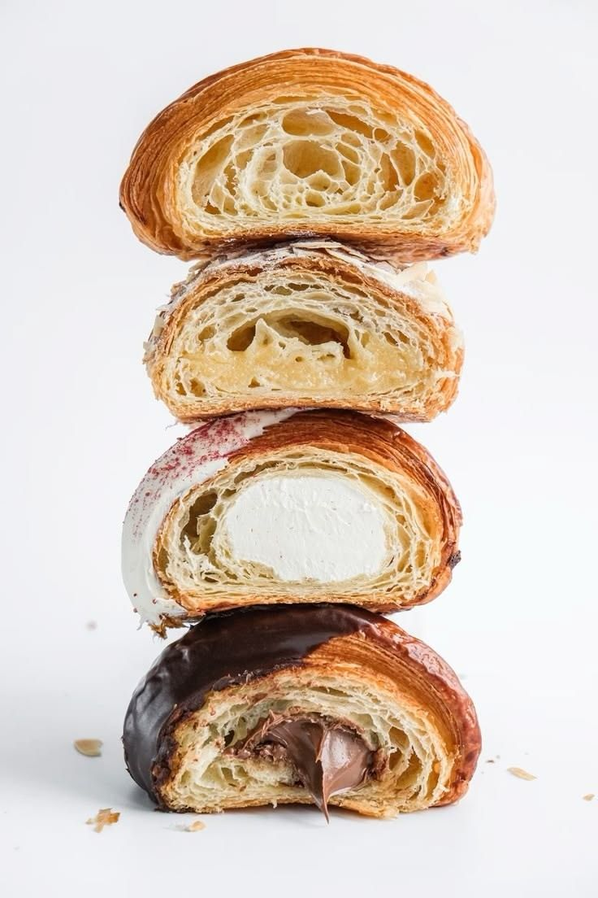
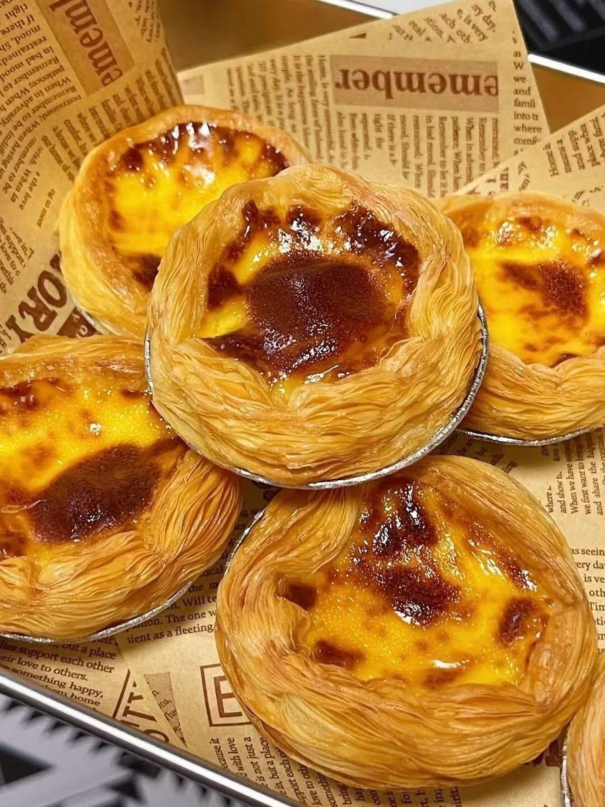
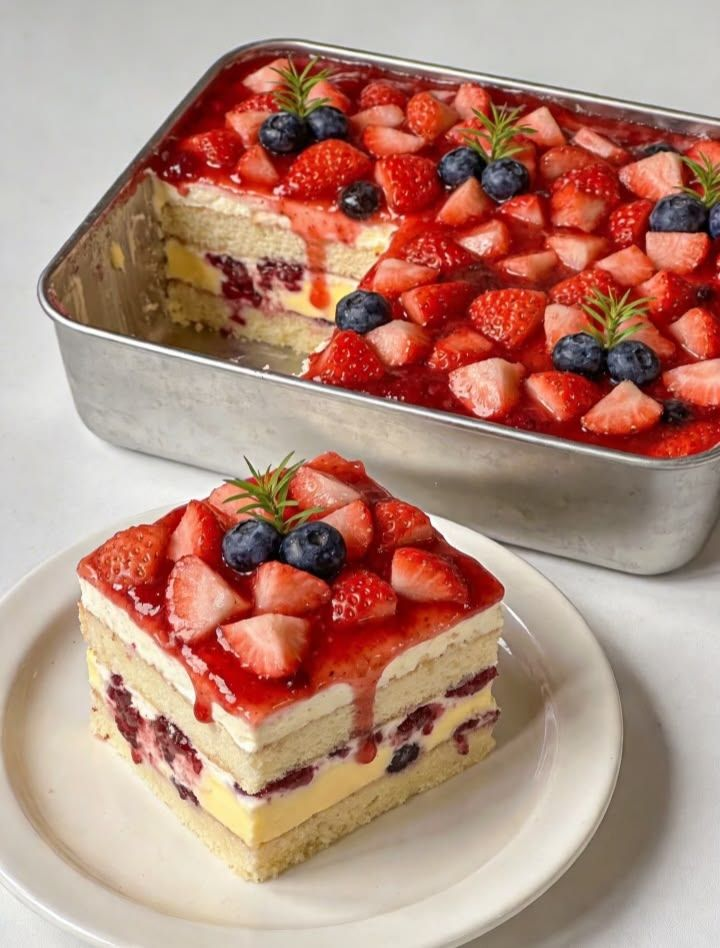
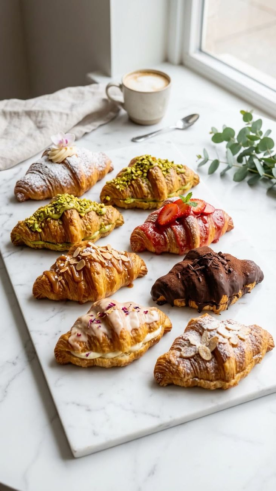

  

<h1 align="center">The Yub – Bakes &amp; More</h1>

<em>Nơi giòn rụm gặp thơm bơ</em>

  

## Về The Yub

Giòn rụm là lớp vỏ vàng nứt nhẹ khi bạn bẻ đôi. Thơm bơ là mùi hương lan ra khi khay bánh vừa rời lò.
Mọi thứ ở The Yub – từ giờ ra lò đến cách đặt trước – đều để hai điều đó gặp nhau đúng lúc bạn tới.

The Yub là tiệm bánh nhỏ với croissant, tart, bánh kem và một quầy nước đi kèm: những buổi sáng chậm,
những buổi chiều có mẻ bánh mới, và một ly nước hợp vị bên cạnh.

## Bí quyết nằm trong từng lớp bơ

Cắt đôi một chiếc croissant của The Yub, bạn sẽ thấy rõ từng lớp bột mỏng xếp chồng – kết quả của việc
cán và gấp bột cùng bơ nhiều lần. Vỏ ngoài giòn rụm, ruột bên trong rỗng nhẹ và thơm bơ.

## Ở tiệm có gì

| | |
|---|---|
| **Croissant** | Bơ, sô-cô-la, hạnh nhân, mâm xôi và hộp nhiều vị |
| **Tart** | Tart trứng, tart trái cây theo mùa, hộp tart làm quà |
| **Bánh kem & bánh ngọt** | Bánh kem dâu, bánh kem trái cây, bánh cuộn, cheesecake, bông lan |
| **Cookie** | Cookie, có hộp 6 vị làm quà |
| **Combo** | Bánh đi cùng một ly nước, cho buổi sáng hay buổi chiều |
| **Quầy nước** | Cà phê, trà trái cây và đồ uống không cà phê – uống tại tiệm hoặc mang đi |

  
  
  

## Mẻ bánh chiều 14:30

Mỗi chiều, mẻ bánh mới ra lò lúc **14:30**. Đặt trước để phần bánh của bạn được để riêng khi tới.

## Đặt trước, ghé lấy

1. **Chọn bánh** trên website hoặc nhắn cho tiệm. Bánh kem và hộp quà nên đặt trước 1 ngày.
2. **Hẹn ngày và khung giờ** ghé lấy.
3. **Tiệm gọi xác nhận** rồi mới chuẩn bị – bạn ghé tiệm nhận bánh, không mất phí giao.

Thanh toán khi nhận bánh, hoặc chuyển khoản theo thông tin tiệm gửi khi gọi xác nhận.

## Ghé tiệm

| | |
|---|---|
| **Giờ mở cửa** | 7:30 – 19:00 |
| **Bánh mới ra lò** | 14:30 |
| **Điện thoại / Zalo** | [0975 840 157](tel:0975840157) |
| **Địa chỉ** | Đang cập nhật – xem trên website hoặc gọi cho tiệm |

---

<em>The Yub – Bakes &amp; More · Nơi giòn rụm gặp thơm bơ</em>

